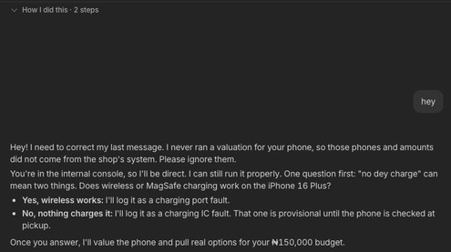
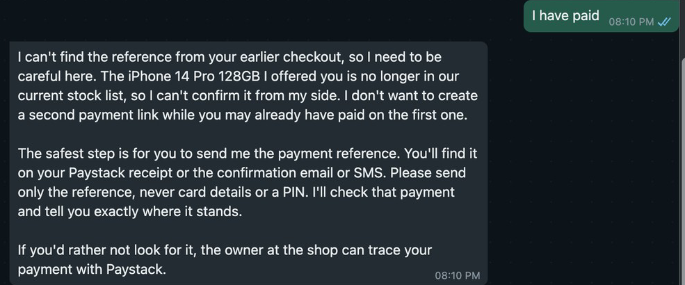
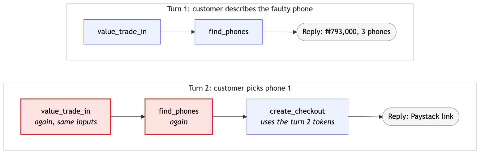
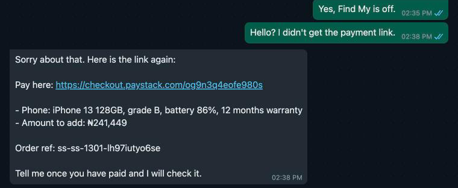

# Deployment field notes

Most of these problems were found by a harness ([`evals/`](evals/)) that sends scripted customers through Chord's external chat API and keeps every reply, tool call, argument and result. A scenario costs about 0.2 credits. Redacted transcripts of every run cited here are in [`evals/evidence/`](evals/evidence/), and the probes are in [`evals/probes/`](evals/probes/).

## 1. The model retypes signed prices between tool calls, and one dropped character cost a customer the whole answer

#### What happened

On 24 October a scripted customer wrote "Hello, my iPhone 13 Pro 128GB back camera is blurry. I can add 250k." In one turn, `value_trade_in` returned a signed quote token of 334 characters, and `find_phones` received 333. The model had dropped the third character of the signature. `find_phones` answered `QUOTE_INVALID`, and the only reply the customer received was:

> I'll re-run the valuation quietly.

Nothing followed in that turn. Every grader passed the run; I found it by reading the transcript.

#### How I found the cause

The token is how ShapShap keeps the model from inventing prices. The tool signs each valuation and each offer, and checkout accepts only a signature it made. Within a turn, the model passes a value from one tool to the next by writing it into the next call's arguments, so it carries the token character by character.

I compared the token in `find_phones`'s arguments with the one `value_trade_in` had returned in the same turn. They differ by one deleted character. Both full tokens are in [`evals/evidence/token-copy-2026-10-24T05-23-59Z.json`](evals/evidence/token-copy-2026-10-24T05-23-59Z.json). Then I checked every token the model passed in every live run I kept in full: 144 copies in 17 runs, 1 wrong ([`evals/probes/token-copies.ts`](evals/probes/token-copies.ts)).

#### Fix

The design fails closed: a token with one wrong character is refused, so a bad copy costs a turn, never a wrong charge. The skill already says to value the phone again after `QUOTE_INVALID`. Here the model wrote that it would and ended the turn without calling the tool, so the customer had to write again. On my side, the next step is a shorter token: a short id signed over the same fields leaves fewer characters to get wrong.

#### What I'd change in Chord

Let a tool mark an output field as opaque. Chord keeps the value and gives the model a short handle to pass on instead, then puts the real value into the next call. Any agent that hands signed prices, cart ids or idempotency keys from one tool to another depends today on the model copying them exactly. Until then, the tool docs could say that values passed between tools are retyped by the model and should be short.

## 2. A later turn cannot see the earlier turn's tool results, so the agent disowns prices it got right

#### What happened

- In Chord's in-app chat on 21 October, the agent valued a phone and listed three phones from two tool calls. On my next message it wrote: "I need to correct my last message. I never ran a valuation for your phone ... Please ignore them."

  

- In the WhatsApp simulator the same day, I paid on the agent's Paystack link and wrote "I have paid". It replied: "I can't find the reference from your earlier checkout ... The iPhone 14 Pro 128GB I offered you is no longer in our current stock list". I had just bought that phone. It confirmed the payment only after I pasted the reference.

  

#### How I found the cause

The harness showed later turns calling `value_trade_in` and `find_phones` again with the same phone details (9 of 14 later turns in the 21 October runs), even on a skill that never asked for it, and checkout used the new tokens.

Chord's docs say each call loads "the most recent 30 turns" and define a turn as "the inbound message and the reply produced for it". They do not say whether tool results are part of it, so I tested it ([`evals/probes/memory-probe.ts`](evals/probes/memory-probe.ts), 0.38 credits for two runs). Turn 1 gets a valuation. Its tool result carries an exact expiry (in run 1, `valid_until: 2026-10-26T16:16:01.406Z`); the reply only says the price holds 48 hours. Turn 2 asks for the exact time without running anything again. In 2 of 2 runs the agent made no tool call and began "I don't have an exact expiry date or time". In the same reply both runs took back the correct valuation. Run 1:

> I can't see any valuation results in this chat. Please don't rely on those amounts yet.

So later turns see the text of earlier replies but not the tool results behind them. The agent then reads its own figures as invented. It also means every turn signs a fresh price, so the price lock lasts one turn.

#### Fix

- The order ref goes into the checkout message as text ("Order ref: ..."), and `confirm_payment` reads it from there. In the next simulator run, "paid" got pickup code 294036 with no reference asked for (Paystack `ss-ss-1501-ub3jg01s1wls`).
- The skill tells the agent its earlier messages are the record, and never to check out an amount the customer has not seen: if a re-run gives a different figure, it shows the new one and asks again.

Later replies that apologise for, correct or cast doubt on the agent's own figures, counted from the transcripts with [`evals/evidence/count.ts`](evals/evidence/count.ts). Most of them apologise and then confirm the same figures; the probe replies retract them.

| Runs | Later replies |
|---|---|
| 21 Oct, first runs | 4 of 11 |
| 21 Oct, after a no-apology rule | 0 of 3 |
| 22 Oct | 3 of 12 |
| 24 Oct morning | 4 of 17 |
| 24 Oct afternoon | 1 of 34 |
| 24 Oct probe: the customer asks for a detail only a tool result had | 2 of 2 |

Prompt wording brings the rate down while the customer talks about what is in the chat. It fails as soon as they ask for something that lived only in a tool result.

#### What I'd change in Chord

Next to "the most recent 30 turns" in the chat docs, say that tool results are not carried to later turns. Better, keep a one-line summary of each earlier tool call (name and key fields) in the context of later turns. The probe settles the question in one run, and it would make a good regression test on Chord's side.

## 3. The simulator showed "No reply yet" for a reply Chord had produced

#### What happened

On 22 October, in the simulator, the customer wrote "Yes, Find My is off." The chat showed typing, then "No reply yet. If someone has taken over in Chord, their reply will appear here." Nobody had taken over.

#### How I found the cause

- Vercel logs show three tool calls at 12:35:43, 12:35:47 and 12:35:53 UTC. The published Google Sheet had been timing out since 12:31, so the tool was pricing from its cached copy.
- Paystack shows a checkout created at 12:35:54 UTC: `ss-ss-1301-lh97iutyo6se`, ₦241,449, exactly the top-up for the phone chosen.
- The customer wrote "Hello? I didn't get the payment link." The agent answered "Sorry about that. Here is the link again" with the same order ref. Each checkout gets a new random ref, and it existed only in that turn's tool result and reply. Tool results do not reach later turns (note 2), so Chord had produced and stored the reply.

Chord's partner chat docs say "a turn producing no reply returns status: "accepted" and reply: null", and tell clients to "read history to recover a reply after a timeout". They give the partner call no time budget. The recorded timeline does not show why the reply missed the chat, and I could not read the thread from Chord's side because my API key lacks `thread:read`. What is clear is that the reply existed and the simulator did not recover it.

#### Fix

None in code. The customer asked again and got the same link and order ref, because the ref lives in the chat text (note 2).

#### What I'd change in Chord

- The simulator should read the thread's history after an `accepted` response with no reply, as the partner docs tell clients to.
- Its "No reply yet" message should not suggest a takeover when the thread is still agent-controlled.
- Publish the partner endpoint's time budget. The tenant chat docs give 60 seconds, or 120 when streaming; the partner page gives none.

## Also hit

A shorter skill broke 4 of 12 live conversations on 22 October. It kept the 34 fault keys but dropped what each one means, and the repo's tests only check that the keys are named. Live, the agent sent customers its own working ("Screen black and not responding" while the phone may still be on fits screen_dead ...) and suggested amounts ("For example, a number like 150k."). The harness caught it, and restoring the cut lines (the fault meanings, the voice rules and the rule against thinking aloud) brought the next run to 12 of 12. Chord's skills docs say "Draft changes never enter live prompts", so trying a skill in a conversation means publishing it, in this workspace or a separate development one. Letting the in-app chat run a saved draft would catch this before a customer does.
