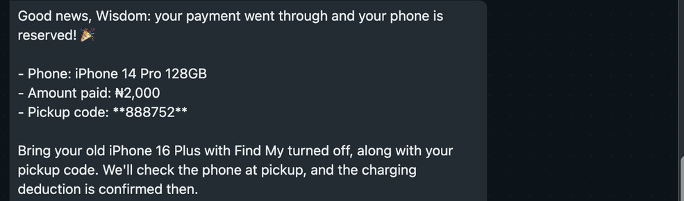
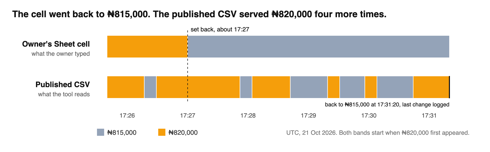

# Deployment field notes

## 1. The agent re-ran its tools each turn and disowned its own figures

#### What happened

- In Chord's in-app chat on skill `v5`, the agent valued a phone and listed three phones from two tool calls. On my next message it wrote: "I need to correct my last message. I never ran a valuation for your phone ... Please ignore them."

  

- In the WhatsApp simulator on skill `v6`, I paid on the agent's Paystack link and wrote "I have paid". It replied: "I can't find the reference from your earlier checkout ... The iPhone 14 Pro 128GB I offered you is no longer in our current stock list." I had just bought that phone. It confirmed the payment only after I pasted the reference.

  

#### How I found the cause

My eval harness sends messages through Chord's external chat API and saves every tool call. On skill `v3`, which never asks for a repeat call, the agent called `value_trade_in` and `find_phones` again on turn 2 with the same phone details. `create_checkout` then used the new turn 2 tokens.

Chord's chat docs say each call loads "the most recent 30 turns". They do not say whether tool results are part of those turns.

#### Fix

- `v5`: re-run tools quietly, with no apology.
- `v6`: earlier figures came from tools, so never retract them.
- `v7`: write `Order ref: [reference]` into the checkout message and confirm payment from that line. In the next simulator run, "paid" got pickup code `294036` with no reference asked for (Paystack `ss-ss-1501-ub3jg01s1wls`).
- `v8`: never check out an amount the customer has not seen. The offer signed on one turn is replaced on the next, so the price lock covers one turn.

#### What I'd change in Chord

Keep tool results, or a one-line summary of each, in the context of later turns. If not, state what "the most recent 30 turns" includes. Four skill versions, `v5` to `v8`, went into working around this.

## 2. The in-app chat does not show what WhatsApp shows

#### What happened

- In the simulator the pickup code arrived as `**888752**`, asterisks visible.
- In Chord's in-app chat, Markdown bold shows as bold and single line breaks are merged.
- The in-app chat accepts photos. The simulator has a text box only.

#### How I found the cause

Chord's chat docs define the reply as "The answer text. Markdown." WhatsApp bold uses one asterisk, so two asterisks show as typed.

#### Fix

- `v6`: each list item on its own `- ` line.
- `v7`: plain text only, no Markdown.

#### What I'd change in Chord

Convert Markdown to WhatsApp formatting on the WhatsApp channel and in the simulator, or add a WhatsApp preview to the in-app chat. State in the docs which surfaces accept images.

## 3. The owner's Sheet returned two prices for six minutes

#### What happened

The tool reads prices from the owner's Google Sheet, published as CSV. I changed phone `SS-1602` from ₦815,000 to ₦820,000, then set it back at about 17:27 UTC. The published CSV kept switching between the two prices, 12 changes in all, the last at 17:31:20.

#### How I found the cause

I fetched the CSV with `curl` every 10 seconds and logged each change. The tool's own parser was not involved.

#### Fix

`find_phones` signs the price it shows into an offer token, and `create_checkout` charges that signed top-up. For go-live, the owner must not change a price while a sale is open.

#### What I'd change in Chord

A Google Sheets connector that reads through the Sheets API. Until then, one line in the tool docs: a sheet published as CSV can return old and new values for minutes after an edit.
