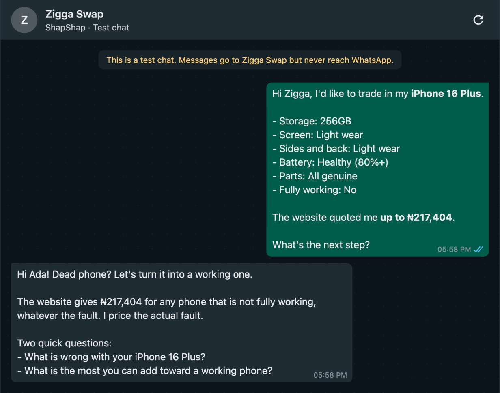
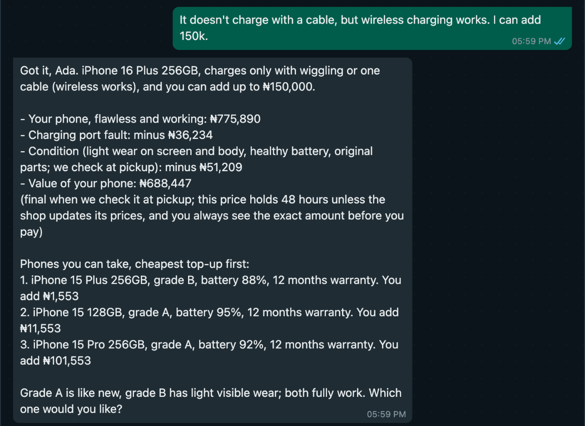

# ShapShap


A pictorial representation of ShapShap.

Role: Forward-deployed Engineering.

Ziggatech, an iPhone store in Ikeja, Lagos, takes old iPhones as part-payment, but its calculator cuts any phone that does not "power on and function normally" to 30%: an iPhone 16 Plus 256GB in light wear drops from ₦724,681 to ₦217,404, whatever the fault. ShapShap answers the calculator's WhatsApp hand-off, asks what is wrong, and takes off Ziggatech's own published repair price for that fault, the repair-cost deduction its FAQ describes. No deduction is smaller than the store's repair price and no offer drops below the website's own figure, so the store can say yes to faulty phones it now prices out. I left out what needs hands or the store's systems: the pickup inspection, cash payouts and live stock.


The [calculator's](https://ziggatech.com/pages/iphone-funnel) FAQ says "Cracked screens and weak batteries still qualify" and "Ziggatech deducts the repair cost from the quote rather than rejecting the device". The calculator itself asks one yes-or-no question for every other fault, from charging to Face ID.

The calculator ends with a WhatsApp button whose message carries the model, storage, the four condition answers and the website's figure, but not the fault. ShapShap is built to sit behind that button with no change to the website. It reads the condition the customer already gave, names the website's figure, and asks only what is wrong and how much they can add. For my phone, a loose charging port, the website's ₦217,404 becomes ₦688,447. ShapShap prices condition exactly as the calculator does, so the customer's answers carry over unchanged.





## Why the store gains

Take a broken rear camera on the same phone. ShapShap offers ₦496,531: the working price of ₦724,681 minus ₦228,150, Ziggatech's published price for that camera repair. The store fixes the camera and owns a working 16 Plus for what it pays for one today, and its own repair cost should be no higher than the price it charges customers. Every deduction is at least the published repair price, and an offer never drops below the website's own figure for the same phone; locked or blacklisted phones get no offer at all.

What I expect but have not measured: at ₦217,404 that customer is better off repairing the phone elsewhere and selling it working, so the store loses the phone and the upgrade it would have sold. The go-live note asks the store to count those chats in the first week.

Faults with no published repair price, such as a loose charging port, come off as a percentage the owner sets in the Google Sheet. The demo's percentages are mine; the go-live note asks the owner to set them.

A demo, not affiliated with Ziggatech. Every phone, price and payment in it is test data.

## How it works

ShapShap is a Chord teammate with one skill (`skills/shapshap`) and one custom tool, an MCP server on Vercel (`tool/`) with four calls:

- `value_trade_in` prices the phone with Ziggatech's website formula, then takes off each fault: the larger of the fault's percentage and Ziggatech's published repair price, never below the website's own quote for a faulty phone.
- `find_phones` offers up to three phones from stock within the customer's budget, each with a signed price.
- `create_checkout` opens a Paystack link for the top-up and holds that phone for 30 minutes, so no other customer is offered it. It refuses unless the agent confirms the customer said Find My is off.
- `confirm_payment` checks Paystack and, if paid, returns a pickup code. The paid transaction is the reservation.

Prices, faults and stock come from the owner's Google Sheet, with `tool/data` as the fallback. Paystack is the record of sales, so there is no database. [FIELD-NOTES.md](FIELD-NOTES.md) covers what broke; [GO-LIVE.md](GO-LIVE.md) is the note for the store owner.

## The skill

`skills/shapshap/SKILL.md` holds the rules, how a chat goes, the 34 fault keys and the persona; `references/faults.md` gives each fault a self-check and the ways Lagos customers describe it; `references/policy.md` holds the store's policy. The fault list comes from Apple's support pages and Lagos repair listings.

## How to run

Node 22.18 or later, and the Vercel CLI, logged in. Copy `.env.example` to `.env` at the repo root and fill it with test keys.

```
cd tool
npm install
npm test               # 67 tests, no network
vercel link            # creates or links the Vercel project
vercel deploy --prod   # after setting the .env variables for Production in Vercel
```

Then in Chord:

1. Admin, Channels & Tools, Custom tools (MCP): add `https://<your-deployment>/api/mcp` with bearer auth and your `MCP_TOKEN`.
2. Create a teammate and add the skill from `skills/shapshap`, with `SKILL.md` as its instructions.
3. Admin, Connected apps: allow approved apps. Then, in the TSG WhatsApp simulator, create a chat link for the teammate.

Conversation evals: `node evals/run.ts --dry` uses a fake Chord and spends no real credits. The harness exists because skill edits that the unit tests cannot check broke live conversations. [`evals/evidence/README.md`](evals/evidence/README.md) lists the few files behind each field note. `node evals/run.ts --runs 1 --budget-credits 6` runs live and needs a Chord key with chat, teammate and usage-read scopes.

## How I used AI tools

I designed and directed ShapShap, and built it with Claude Code. I picked the business and the problem, set the requirements and worked spec first: for each major change I approved a written spec with acceptance tests before any code, the tests were written to fail first, and a separate reviewer checked the result against the spec and Ziggatech's live pages. I did the research, using Claude to search and read the sources: Ziggatech's pages and the Paystack and Chord docs. Claude wrote the code, the tests and first drafts of these documents. I made the product calls, ran the production deploys and made the in-browser Paystack test payments. The reviews caught real errors, such as one phone sold twice and a price lock that held for one turn only.

## What stopped me

- Paying customers out. My Paystack starter account refuses transfers ("You cannot initiate third party payouts as a starter business"), so ShapShap collects a top-up toward a better phone instead of buying phones for cash. Cash sales stay with the store.
- Tool results between turns. Later turns do not see them, which a probe confirmed and the docs do not mention. The workaround is in field note 2; it also limits the price lock to one turn.
- No access to Ziggatech. Base prices and repair costs come from their public pages; fault percentages are mine, and stock is made up from Lagos listings. I do not know how many faulty-phone chats they get.
- Reading conversations through the API. My key lacks `thread:read`, so a lost reply could be traced only through Vercel and Paystack (field note 3).
- Photos. The simulator takes text only, and a photo of the crack is how a real customer would start.

With more time: connect real stock and let customers ask for a model, a pickup-code lookup for counter staff, alerts to the owner, photo intake, and a week of real chats with Ziggatech to size the problem.
