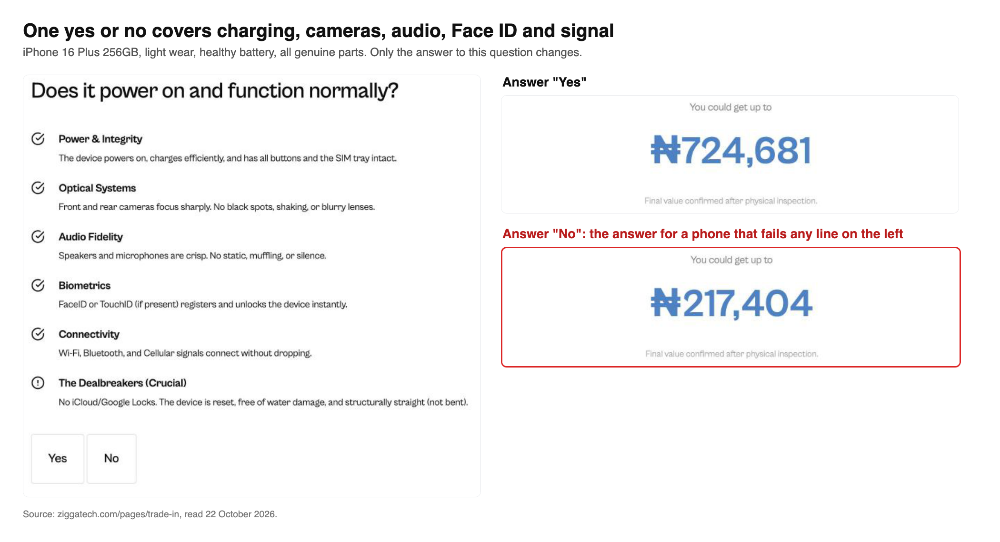
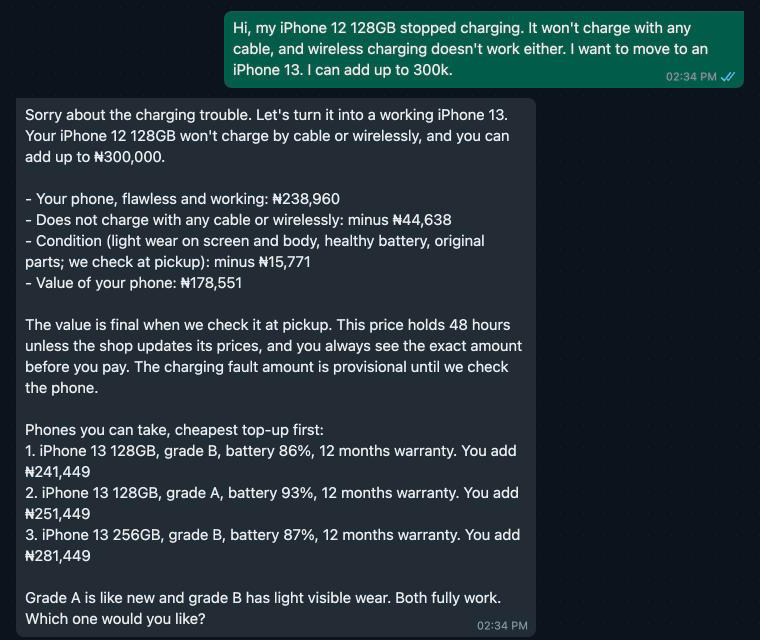

# ShapShap

Role: Forward-deployed Engineering.

Ziggatech, an iPhone store in Lagos, takes old iPhones as part-payment, but its website offers 70% less for any phone that is not fully working. My own iPhone 16 Plus 256GB stopped charging, and for one in light wear the website offers ₦217,404 instead of ₦724,681, whatever the repair costs. ShapShap prices the actual fault on WhatsApp from the store's own repair prices and takes the balance on Paystack, without costing the store its margin. I deliberately left out what needs hands or the store's systems: the pickup inspection, cash payouts and live stock.



The cut is in the calculator's own code on [ziggatech.com/pages/iphone-funnel](https://ziggatech.com/pages/iphone-funnel): `const funcMult = selections.functional === 'no' ? 0.3 : 1.0;`. Its FAQ says Ziggatech deducts the repair cost, but that answer covers cracked screens only.



A demo, not affiliated with Ziggatech. Every phone, price and payment in it is test data.

## How it works

ShapShap is a Chord teammate with one skill (`skills/shapshap`) and one custom tool, an MCP server on Vercel (`tool/`) with four calls:

- `value_trade_in` prices the phone with Ziggatech's website formula, then takes off each fault: the larger of the fault's percentage and Ziggatech's published repair price, never below the website's own quote for a faulty phone.
- `find_phones` offers up to three phones from stock within the customer's budget, each with a signed price.
- `create_checkout` opens a Paystack link for the top-up, and refuses unless the agent confirms the customer said Find My is off.
- `confirm_payment` checks Paystack and, if paid, returns a pickup code. The paid transaction is the reservation.

Prices, faults and stock come from the owner's Google Sheet, with `tool/data` as the fallback. Paystack is the record of sales, so there is no database. [FIELD-NOTES.md](FIELD-NOTES.md) covers what broke; [GO-LIVE.md](GO-LIVE.md) is the note for the store owner.

## The skill

`skills/shapshap/SKILL.md` holds the rules, how a chat goes, the 34 fault keys and the persona; `references/faults.md` gives each fault a self-check and the ways Lagos customers describe it; `references/policy.md` holds the store's policy. The fault list comes from Apple's support pages and Lagos repair listings.

## How to run

Node 22.18 or later, and the Vercel CLI, logged in. Copy `.env.example` to `.env` at the repo root and fill it with test keys.

```
cd tool
npm install
npm test               # 58 tests, no network
vercel link            # creates or links the Vercel project
vercel deploy --prod   # after setting the .env variables for Production in Vercel
```

Then in Chord:

1. Admin, Channels & Tools, Custom tools (MCP): add `https://<your-deployment>/api/mcp` with bearer auth and your `MCP_TOKEN`.
2. Create a teammate and add the skill from `skills/shapshap`, with `SKILL.md` as its instructions.
3. Admin, Connected apps: allow approved apps. Then, in the TSG WhatsApp simulator, create a chat link for the teammate.

Conversation evals: `node evals/run.ts --dry` uses a fake Chord and spends no real credits. `node evals/run.ts --runs 1 --budget-credits 6` runs live and needs a Chord key with chat, teammate and usage-read scopes.

## How I used AI tools

I designed and directed ShapShap, and built it with Claude Code. I picked the business and the problem, set the requirements and worked spec first: for each major change I approved a written spec with acceptance tests before any code, the tests were written to fail first, and a separate reviewer checked the result against the spec and Ziggatech's live pages. I did the research, using Claude to search and read the sources: Ziggatech's pages and the Paystack and Chord docs. Claude wrote the code, the tests and first drafts of these documents. I made the product calls, ran the production deploys and made the in-browser Paystack test payments. The reviews caught real errors, such as one phone sold twice and a price lock that held for one turn only.

## What stopped me

- Paying customers out. My Paystack starter account refuses transfers ("You cannot initiate third party payouts as a starter business"), so ShapShap collects a top-up toward a better phone instead of buying phones for cash. Cash sales stay with the store.
- Tool results between turns. In my runs Chord did not keep them, which the docs do not mention. The workaround is in field note 1; it also limits the price lock to one turn.
- No access to Ziggatech. Base prices and repair costs come from their public pages; fault percentages are mine, and stock is made up from Lagos listings. I do not know how many faulty-phone chats they get.
- Reading conversations through the API. My key lacks `thread:read`, so a lost reply could be traced only through Vercel and Paystack (field note 2).
- Photos. The simulator takes text only, and a photo of the crack is how a real customer would start.

With more time: connect real stock and let customers ask for a model, a pickup-code lookup for counter staff, alerts to the owner, photo intake, and a week of real chats with Ziggatech to size the problem.
