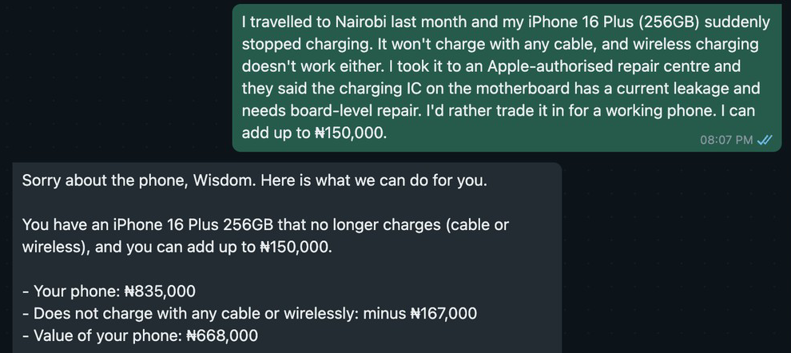

# ShapShap

Role: Forward-deployed Engineering.

Ziggatech, an iPhone store in Lagos, takes old iPhones as part-payment, but its website offers 70% less for any phone that is not fully working. That is ₦507,277 off an iPhone 16 Plus with a broken camera, which Ziggatech's own repair desk fixes for ₦228,150. ShapShap prices the actual fault on WhatsApp from the store's own repair prices and takes the balance on Paystack, without costing the store its margin. I deliberately left out what needs hands or the store's systems: the pickup inspection, cash payouts and live stock.

A demo, not affiliated with Ziggatech. Every phone, price and payment in it is test data.

## How to run

To be written.

## How I used AI tools

To be written.

## What stopped me

To be written.
